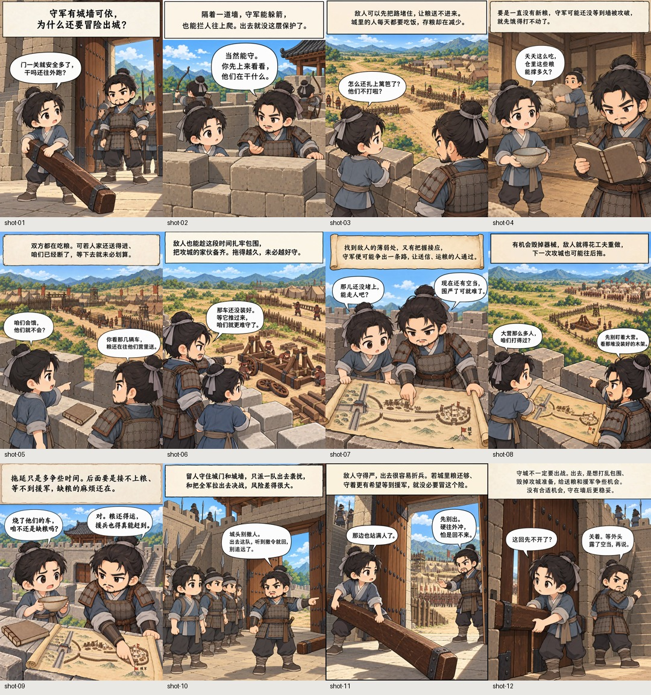
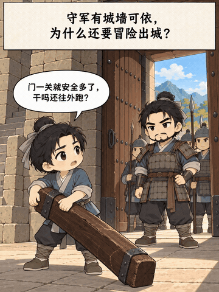

# 脑洞漫工厂

**Skills 名称：`brain-comic`**

输入一个主题，AI 自动完成故事策划、漫画分镜、Q版图片生成与动画视频制作，让创意一键变成漫画短视频。

适合知识科普、公众号图文、自媒体图集和短视频解说。既能交付一组按顺序排好的漫画，也能继续合成为带 BGM 的视频。

**主题 → 故事策划与分镜 → 角色 / 场景 / 道具参考 → 漫画图片集 → 视频（可选）**

## 看看实际效果

示例主题：**为什么古代守城，还要出城打？**

下面是实际生成的 12 张漫画。角色、场景和道具通过参考图保持连续，图片里的旁白与对白共同解释问题。



视频示例采用 **0.5 秒交叉淡化，无推拉**，12 张共 **42 秒**。



[查看完整视频示例](assets/demo/comic-demo.mp4) · 展示版不附配乐，实际制作可使用用户提供的 BGM 文件夹。

## 开始使用

将整个 `brain-comic` 文件夹放入支持 Agent Skills 的助手技能目录，保持目录内文件完整。以 Codex 为例，安装到 `~/.codex/skills/brain-comic/`，然后在助手中使用 `$brain-comic`。

没有技能安装入口的助手，也可以直接读取本目录的 [SKILL.md](SKILL.md)，按其中规则执行。创作内容放在独立主题目录，不需要原开发工程中的登录、保活或发布脚本。

### 给一个主题

```text
使用 $brain-comic。
主题：为什么古代守城还要出城打？
做成12张2D Q版科普漫画，只要图片集。
```

助手会完成文案、分镜、需要跨图复用的参考资产和漫画画面，再整理图片集。知识类主题先讲清因果、回答开头的问题，再设计画面；对白使用自然白话。

画面默认 12 张，数量、画风、受众和语气都可以指定。不需要视频时，交付图片集后结束。

### 生成带 BGM 的短视频

```text
使用 $brain-comic。
主题：古人出门怎么认路？做12张漫画，并生成视频。
BGM从我提供的文件夹选择：/你的/BGM目录
每张约3.5秒，使用交叉淡化，不要推拉。
```

默认每张约 **3.5 秒**、转场 **0.5 秒交叉淡化**，图片保持静止。转场和图片运动分开配置，可以独立修改。

配乐优先从用户指定的目录选择。没有本地音源或已配置音乐服务时，可明确选择导出待平台添加热歌的视频；助手会标记尚未配乐，不用其他曲目悄悄替代。

### 用自己的 IP 角色

附上角色图，再说明名字和分工：

```text
使用 $brain-comic，主题：为什么月亮会有阴晴圆缺？
使用我附上的IP角色“小团”担任讲解员。
保留它的脸型、颜色、身体比例和标志性配饰。
其余配角按需要设计，交付10张漫画图片集。
```

用户角色图直接作为参考使用，跳过重新设计，不强制改成白底三视图。表情和动作随剧情变化，角色身份特征优先于默认 Q 版设定。可以只指定主角，也可以指定多个角色。

### 分步修改

```text
先只做文案和分镜，我确认后再生图。
```

```text
第3张的对白太生硬，先改对白，再重做这一张。
```

```text
只整理最终图片集，不要视频；未采用的旧图放到另一个目录。
```

## 最后会得到什么

| 交付物 | 内容 |
| --- | --- |
| 漫画图片集 | 每张只保留检查通过的当前版本，按 `001-标题.png`、`002-标题.png` 排序 |
| 图片集 ZIP | 压缩包内只有最终漫画，便于下载、转发或上传 |
| 图片预览 | 按剧情顺序浏览整套漫画 |
| 视频（可选） | MP4，使用同一套最终图片及选定 BGM |

每个主题独立保存。最终图片与生成候选、未采用版本分开，用户不用在 v1、v2、v3 中自己挑选；原图保持原尺寸，旧版本保留归档。

```text
主题目录/
├── content.md                    文案与分镜（也可为选定的修订版）
├── images/
│   ├── comic/                    最终漫画图片集
│   │   ├── 001-画面标题.png
│   │   └── 002-画面标题.png
│   ├── comic.zip                 最终图片压缩包
│   ├── comic-preview.md          按序预览
│   ├── assets/                   当前参考资产
│   ├── candidates/               待检查候选
│   └── not-selected/             未采用版本
└── video/                        按需输出视频
```

## 生图与运行环境

生图优先使用已有 API，其次使用助手实际提供的生图工具。两者都没有时，可以通过器灵浏览器授权使用图片 API，无需把 API Key 发给助手。

- 默认画风：**2D Q版漫画**，画风与角色描述分别维护。
- 默认器灵平台：`https://toolsoul.daniu7.cn`。
- 默认模型：`doubao-seedream-5-0-flash`。
- API Key 保存到系统安全凭据库；具体模型能力与费用以器灵平台为准。
- 本地脚本需要 Python 3.10+；视频制作另需 FFmpeg 和 ffprobe。图片导入、整理及参考图打包使用 Pillow；器灵脚本可由 uv 自动准备其声明的依赖。

首次使用器灵通道时，可让助手发起授权，或在本目录执行：

```sh
uv run scripts/qiling_images.py authorize
```

用户在浏览器自行登录并确认。器灵授权与调用已接入并通过模拟测试；本项目暂未完成真实授权和该模型的付费生图联调。用户自带 IP 的传图绑定已测试，实际还原效果仍需生成后检查。

视频目前采用图片顺序播放和转场动画，支持 BGM；不会让角色本身动起来，也不自动生成配音。

更多执行细节见 [SKILL.md](SKILL.md)、[图片集与参考图绑定](references/shot-composition.md)、[视频与配乐](references/video-composition.md) 和 [器灵授权](references/qiling-api.md)。
